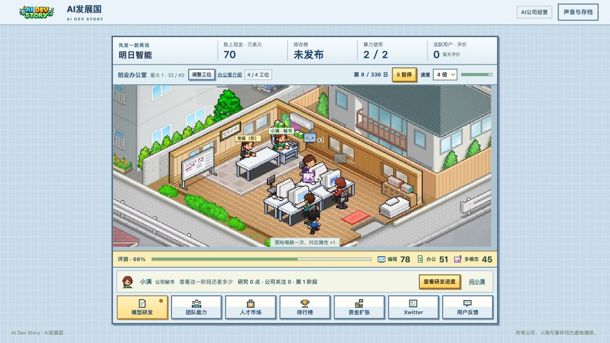

# AI发展国 · AI Dev Story

**模型还没做，发布会先订了。**

一款像素风 AI 公司经营游戏。从两名员工和一间小办公室起步，招人才、买算力、训练模型，在排行榜和工资账单之间寻找生存空间。模型要不要开源，实验要不要加跑，已知 bug 要不要带着上线——每个决定都可能成为下一条行业笑话。

## [立即游玩 →](https://degraw4.github.io/ai-dev-story-play/)

## 游戏特色

- **经营一家 AI 公司**：把有限预算分给研发、设备、工资和宣传，从第一款模型的收入开始扩张。
- **组建你的团队**：招聘各有所长的员工，安排进修和晋升，在能力成长、休整与眼前的工期之间取舍。
- **研发与发布模型**：选择训练投入，应对数据提案和追加实验，决定先修问题还是抢先发布，再看榜单和用户如何回应。
- **选择开放或闭源**：保留独占收入，或用开放权重换取社区关注；同行也会从公开成果中学习。
- **围观 Xwitter**：预热新品、介绍技术、回应同行，夹在发布公告、员工吐槽和开发者反馈之间经营公司的名声。
- **看办公室热闹起来**：调整工位，观察员工走动、讨论和错峰上下班，带着团队搬进更大的总部。

## 开始经营

1. 为公司起名，选择老板与秘书的形象，跟随小满认识办公室。
2. 创建第一款模型，选定主攻方向和方案负责人，让团队开始研发。
3. 发布模型后查看排名、反馈与账单，安排下一代投入，争取在行业评选中留下名字。

经营过程中可随时暂停或调整速度，分多次继续同一家公司的故事。

## 保存进度

进度自动保存在当前浏览器。换设备、清理浏览器数据或更换游玩地址前，请在“声音与存档”中导出备份，再到新环境导入。

## 许可

项目代码与原创素材采用 [MIT License](LICENSE)。第三方场景素材的来源与适用范围见 [素材说明](ASSET_NOTICES.md)。公司、人物和事件均为虚构讽刺创作。
